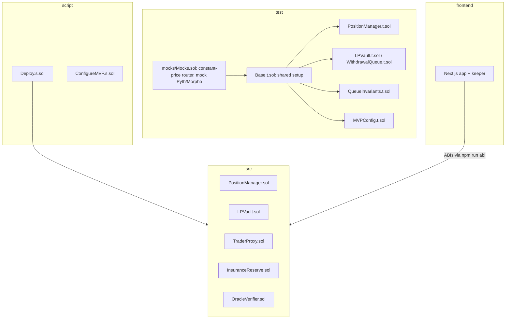
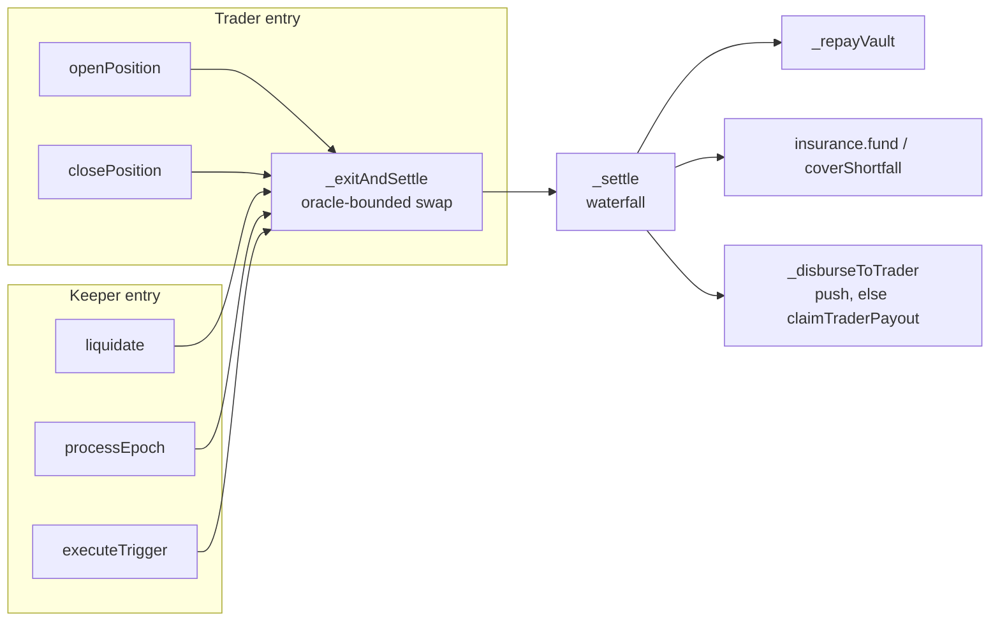
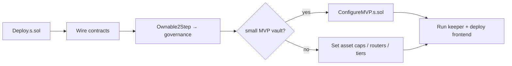

# Development Guide

Low-level docs for contributors. For the high-level picture, start with the [README](README.md).

## Setup

```bash
npm install                 # forge 1.7.1 + OpenZeppelin 5.4.0 from npm
git submodule update --init # forge-std
```

## Build & test

```bash
npm run build   # compile + contract sizes (PositionManager ~17.7 KB)
npm test        # 72 tests incl. 512-run fuzzes and a 256x64 queue invariant suite
npm run fmt     # forge fmt
```

Run a single test: `npm run forge -- test --match-test <name> -vvv`

## Repo map



| Path | Role |
|---|---|
| `src/PositionManager.sol` | Entry point for traders and keepers: opens positions, rolls epochs, liquidates, runs the settlement waterfall |
| `src/LPVault.sol` | `spUSDC` ERC-4626 vault (UUPS) with ERC-7540 async redemptions: Morpho buffer, lending to proxies, 12h linear profit vesting, 85% utilization cap, 30-day exit queue, stress bonus pot, solvency gate |
| `src/TraderProxy.sol` | Per-position EIP-1167 clone; swaps only through whitelisted routers and checks its own balance after each swap |
| `src/InsuranceReserve.sol` | First-loss bucket and ops-treasury bucket |
| `src/OracleVerifier.sol` | Pyth pull oracle: data at most 5s old, confidence within 50 bps; prices normalised to 1e18 |
| `script/Deploy.s.sol` | Arc deployment and wiring, then hand-off to governance via Ownable2Step |
| `script/ConfigureMVP.s.sol` | Retunes a deployed protocol for a ~$100 vault with $5-$10 positions |
| `frontend/` | Landing, dashboard, trade terminal, LP vault UI, keeper bot ([frontend/README.md](frontend/README.md)) |

## Contract call flow



Key invariants to keep when changing code:

- Every swap (entry, exit, liquidation) is bounded by the oracle mark.
- Proxy trusts only its own balance delta, never router return values.
- Debt accrues lazily: `_catchUpEpochs` runs before any close/liquidation/trigger.
- Nothing in the LP queue may block or reduce a trader payout.
- No function is `payable`; Arc native balance and the `0x3600` ERC-20 are the same USDC.

## Adding a feature: checklist

1. Change the contract in `src/`; keep `PositionManager` under the 24 KB limit (`npm run build`).
2. Add tests next to the closest existing suite (reuse `Base.t.sol`); fuzz anything with arithmetic.
3. `npm run fmt && npm test`.
4. If the ABI changed: `npm run build`, then `cd frontend && npm run abi && npm run typecheck`.
5. Mirror any new revert in `frontend/src/lib/errors.ts` and any settlement-rule change in `frontend/src/lib/math.ts` (the landing calculator uses it).
6. Open a PR describing the *why*; note any spec deviation in the list below.

## Deploy



See the [MVP launch checklist](frontend/README.md#mvp-launch-checklist-100-vault-510-trades) for the full step list.

## Implementation decisions beyond / deviating from the spec

1. **Every exit swap is bounded by the oracle, including the trader's own close.** If only `liquidate()` were
   bounded, a trader could close into a pool they had manipulated themselves. The swap output would come out low,
   the shortfall would land on LP principal, and the trader would pocket the difference through the pool. For the
   same reason, `openPosition` rejects any fill worse than `maxEntrySlippageBps` against the oracle.
2. **The proxy measures its own balance changes.** It does not rely on what the router reports. Router calldata
   that sends the proceeds to a different recipient therefore fails the `minOut` check.
3. **Rollover debt is charged up front for each epoch and accrues lazily.** If keepers are late, `closePosition`,
   `liquidate` and `executeTrigger` first charge every epoch that has fallen due. A pure roll in `processEpoch`
   pays no bounty, because skipping it never lets debt go unaccrued.
4. **An expired position that is also below the liquidation threshold settles as a liquidation, not an expiry.**
   The same applies to a triggered stop-loss below the threshold. A trader therefore cannot use a stop order to
   avoid the liquidation penalty.
5. **`addMargin` repays vault principal directly.** It lowers B, which reduces both the liquidation threshold and
   the base for rollover fees. M₀ grows by the same amount, so the trader gets it back before the profit split.
6. **The Pyth fee is paid without any payable function.** On Arc the native balance and the `0x3600` ERC-20
   balance are the same USDC. `PositionManager` therefore takes the fee from the caller as an ERC-20 transfer to
   `OracleVerifier`, which then pays Pyth in native units.
7. **There is no "claim to another address" path.** With one, a trader on the Circle blocklist could route
   deferred payouts to a clean address.
8. **Swap instructions are explicit `{router, minAmountOut, data}` structs** rather than an opaque `bytes swapData`.
9. **Uniswap v4 / UniversalRouter goes through a whitelisted adapter.** The proxy grants a plain exact ERC-20
    approval and revokes it after the swap. UniversalRouter pulls tokens through Permit2, so it needs a small
    adapter that pulls with `transferFrom` and calls Permit2 itself.
10. **USDC is enforced at deployment.** The constructor and initializer require `0x3600…0000` whenever the chain
    ID is 5042 or 5042002, and they also check that the token has 6 decimals.
11. **The LP vault applies a virtual-share offset of 6** against first-depositor inflation attacks, so `spUSDC`
    shares have 12 decimals.

## LP lifecycle: exit queue, stress bonus and solvency gate

Spec: issue #1. Deposits are synchronous; redemptions are asynchronous (ERC-7540). Traders pay nothing for any of
this, and no part of it can block, delay or reduce a trader payout.

1. **Request.** `requestRedeem(shares, controller, owner)` escrows the shares in a FIFO queue for `redeemCooldown`
   (30 days). From that moment the shares **stop earning**: the payout is capped at their value when requested,
   while losses during the wait still apply.
2. **Stress penalty.** The pool is *stressed* when utilisation is at or above `stressUtilizationBps` (80%; the hard
   allocation cap stays at 85%). A request made while stressed also forfeits `exitPenaltyBps` (25%) of the yield
   earned *before* the request. It never touches principal: the payout is floored at `min(cost basis, value)`.
3. **Fulfil.** Anyone can call `processRedemptions(n)`. Matured requests are paid FIFO, with partial fills, out of
   `fulfilmentBudget()`, which is free liquidity minus the PositionManager's worst-case stressed LP loss (net of
   insurance). The payout is reserved as local USDC; the controller claims with `redeem`/`withdraw`. Cancelling a
   pending request also forfeits any queue-period gain.
4. **Bonus pot.** Every forfeit (queue gain, stress penalty, cancel, broken ticket) goes into `bonusPot`. While
   stressed, `depositWithBonus` locks a new deposit for `bonusDuration` (90 days) and streams the pot to it
   (`pot / 90 days` per second, capped at 20% APR per ticket). At maturity anyone can call `claimTicket`; the bonus
   is minted as `spUSDC`. `breakTicket` unlocks early and returns the accrued bonus to the pot. The scheme is
   zero-sum: bonuses are only ever paid from the pot.
5. **Solvency gate.** `PositionManager.stressedLPLoss()` bounds the LP loss if every asset dropped by its
   `stressShockBps` (20%) and every position were liquidated at maximum slippage. Positions sit above
   `V = B + D + mu*N`, so the loss per position is at most `B * k(asset, tier)`. The bound is exact from
   per-(asset, tier) borrowed aggregates, with no loop over positions. It assumes keepers liquidate promptly.
6. **Priority.** New trader allocations cannot use liquidity owed to pending requests (`AllocationBlockedByQueue`).

Every parameter is owner-configurable within bounds (`setQueueParams`, `setBonusParams`, the per-asset shock in
`setAsset`). Existing requests and tickets keep the terms they were created with.

## Known gaps before audit

- `OracleVerifier` integrates Pyth only. Chainlink fallback is not implemented, and USDC is assumed to equal $1.
- No Uniswap v4 adapter is included yet (see decision 9).
- `executeTrigger` lets the trader or an operator raise `trailingStopPrice`. There is no on-chain high-water tracking.
- The tests use a constant-price router. No fork tests have been run against real Arc pools or MetaMorpho.
- The solvency-gate bound assumes keepers liquidate promptly. A position left below its threshold can lose more than the bound predicts.
- New allocations are blocked by *all* pending requests, not just matured ones. This is more conservative than the spec.
