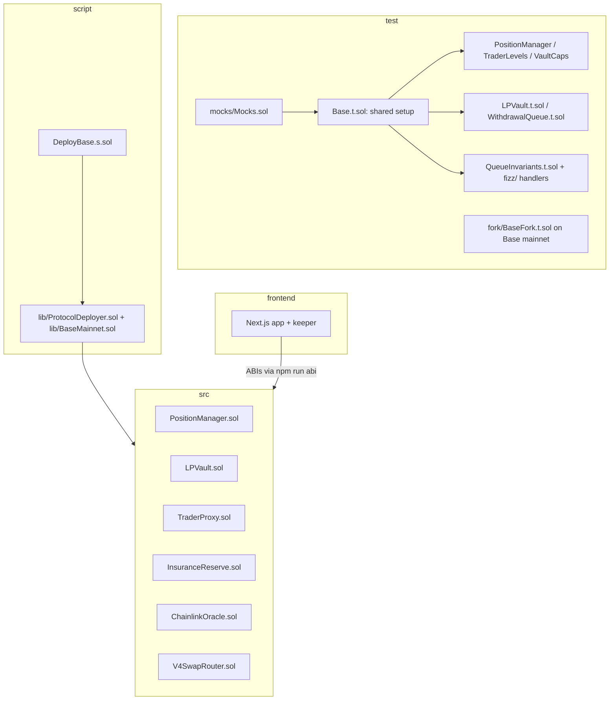
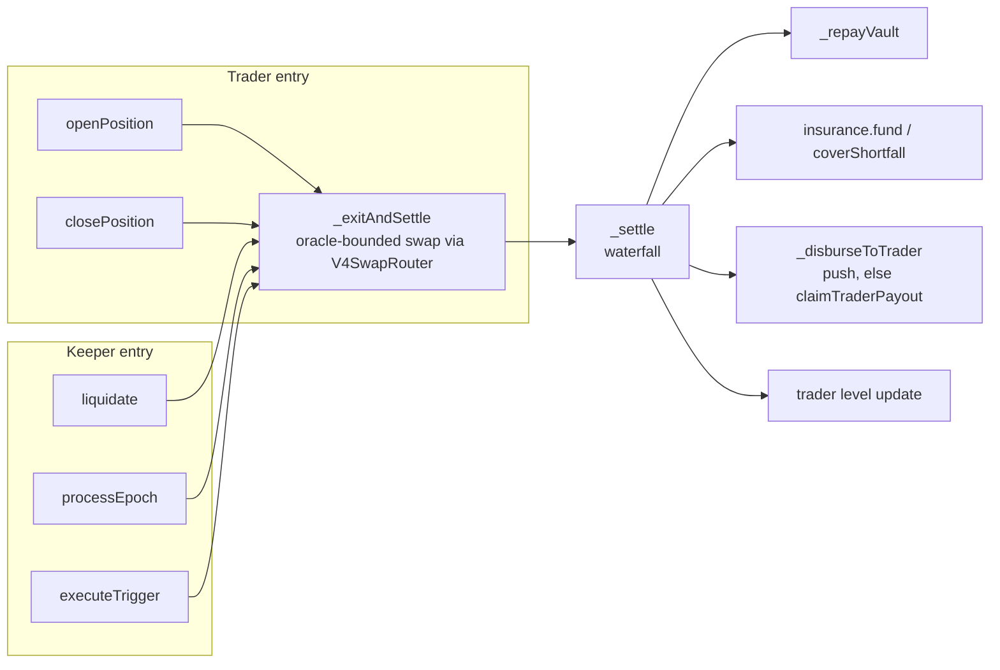
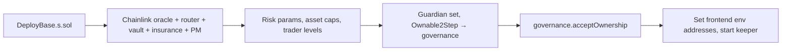

# Development Guide

Low-level docs for contributors. For the high-level picture, start with the [README](README.md).

## Setup

```bash
npm install                 # forge / anvil / cast 1.7.1, OpenZeppelin 5.4.0, Uniswap v4-core 1.0.2 from npm
git submodule update --init # forge-std
```

## Build & test

```bash
npm run build       # compile + contract sizes
npm test            # unit, fuzz and invariant suites (fork suites skipped)
npm run test:fork   # Base mainnet fork: real Chainlink feeds, real v4 pools, deposit → open → close
npm run fmt         # forge fmt
```

Run a single test: `npm run forge -- test --match-test <name> -vvv`

`npm run test:fork` forks `https://mainnet.base.org` unless `BASE_RPC_URL` is set; `FORK_BLOCK` pins a block. The
suite deploys the protocol exactly as `script/DeployBase.s.sol` does (`ProtocolDeployer.deployBase`), checks the
feeds and caps, and runs a real deposit, open and close on the WETH/USDC pool.

## Repo map



| Path | Role |
|---|---|
| `src/PositionManager.sol` | Entry point for traders and keepers: opens positions, rolls epochs, liquidates, runs the settlement waterfall, tracks trader levels (UUPS) |
| `src/LPVault.sol` | `spUSDC` ERC-4626 vault (UUPS) with ERC-7540 async redemptions: lending to proxies, 12h linear profit vesting, 85% utilization cap, 30-day exit queue, stress bonus pot, solvency gate, deposit caps. Idle USDC can sit in a MetaMorpho vault (`IDLE_VAULT`; `address(0)` = single-vault mode) |
| `src/ChainlinkOracle.sol` | Chainlink ETH/USD and BTC/USD marks normalised to 1e18, with staleness, round and optional L2-sequencer checks; also stores each asset's v4 pool key |
| `src/UniV4TwapOracle.sol` | Alternative keeper-recorded TWAP oracle for chains without Chainlink; not used on Base |
| `src/V4SwapRouter.sol` | Minimal exact-input, single-pool v4 router (unlock callback, plain ERC-20 approval, no Permit2) |
| `src/TraderProxy.sol` | Per-position EIP-1167 clone; swaps only through the whitelisted router and checks its own balance after each swap |
| `src/InsuranceReserve.sol` | First-loss bucket and ops-treasury bucket |
| `script/DeployBase.s.sol` | Base mainnet deployment, then hand-off to governance via Ownable2Step |
| `script/lib/BaseMainnet.sol` | Base addresses: USDC, WETH, cbBTC, v4 PoolManager, Chainlink feeds and both pool keys (WETH/USDC 0.30%, cbBTC/USDC 0.05%) |
| `script/lib/ProtocolDeployer.sol` | `deployBase`: oracle feeds, router, vault, insurance, risk params, asset caps and trader levels |
| `frontend/` | Landing, backtest, dashboard, trade terminal, LP vault UI, keeper bot ([frontend/README.md](frontend/README.md)) |
| `sim/` | Backtest and lender-equilibrium simulator; results published to Arkiv ([sponsors/arkiv](sponsors/arkiv/README.md)) |

## Contract call flow



Key invariants to keep when changing code:

- Every swap (entry, exit, liquidation) is bounded by the oracle mark.
- The protocol builds the swap calldata; callers only supply `minAmountOut`.
- Proxy trusts only its own balance delta, never router return values.
- Debt accrues lazily: `_catchUpEpochs` runs before any close/liquidation/trigger.
- Nothing in the LP queue may block or reduce a trader payout.
- No function is `payable`.

## Adding a feature: checklist

1. Change the contract in `src/`; keep `PositionManager` under the 24 KB limit (`npm run build`).
2. Add tests next to the closest existing suite (reuse `Base.t.sol`); fuzz anything with arithmetic. Add a fork test if it touches real pools.
3. `npm run fmt && npm test`.
4. If the ABI changed: `npm run build`, then `cd frontend && npm run abi && npm run typecheck`.
5. Mirror any new revert in `frontend/src/lib/errors.ts` and any settlement-rule or level change in `frontend/src/lib/math.ts` and `frontend/src/components/landing/Calculator.tsx`.
6. Open a PR describing the *why*; note any spec deviation in the decisions list below.

## Deploy (Base mainnet)

```bash
BASE_RPC_URL=… GOVERNANCE=0x… GUARDIAN=0x… [IDLE_VAULT=0x…] \
  forge script script/DeployBase.s.sol --rpc-url base --broadcast --account <deployer>
```



Then set `NEXT_PUBLIC_POSITION_MANAGER`, `NEXT_PUBLIC_LP_VAULT`, `NEXT_PUBLIC_ORACLE` and `NEXT_PUBLIC_INSURANCE`
in Vercel and run the keeper (`cd frontend && npm run keeper`). See [frontend/README.md](frontend/README.md).

## Price oracle: Chainlink

`ChainlinkOracle.getPrice(asset)` returns USD per whole token at 1e18, with USDC = $1. It reverts when:

- the answer is zero or negative (`InvalidPrice`), or the round is incomplete (`RoundNotComplete`);
- the feed has not updated within `maxStaleness` (3600 s on Base, `StalePrice`);
- a sequencer-uptime feed is set and the sequencer is down or inside its grace period (off by default).

Every risk decision (entry check, exit floors, liquidation, epoch, stop-loss / take-profit) uses this mark. Trades
fill on the asset's Uniswap v4 USDC pool, whose key the oracle stores; the fill must land within
`maxEntrySlippageBps` / `maxExitSlippageBps` (1%) or `maxLiqSlippageBps` (2%) of the mark.

## Implementation decisions beyond / deviating from the spec

1. **Every exit swap is bounded by the oracle mark, including the trader's own close.** The swap must return at least
   `max(minAmountOut, mark × (1 − maxSlippage))` with the mark from Chainlink. If only `liquidate()` were bounded, a
   trader could close into a pool they had manipulated themselves and push the shortfall onto LP principal. For the
   same reason, `openPosition` rejects any fill worth less than `notional × (1 − maxEntrySlippageBps)` at the mark.
   Consequence: when the pool trades more than the allowed slippage below the mark (a fast crash, or a dump),
   exits revert until the pool recovers.
2. **The proxy measures its own balance changes.** It does not rely on what the router reports. Router calldata
   that sends the proceeds to a different recipient therefore fails the `minOut` check.
3. **Rollover debt is charged up front for each epoch and accrues lazily.** If keepers are late, `closePosition`,
   `liquidate` and `executeTrigger` first charge every epoch that has fallen due. A pure roll in `processEpoch`
   pays no bounty, because skipping it never lets debt go unaccrued.
4. **An expired position that is also below the liquidation threshold settles as a liquidation, not an expiry.**
   The same applies to a triggered stop-loss below the threshold. A trader therefore cannot use a stop order to
   avoid the liquidation penalty.
5. **`addMargin` repays vault principal directly.** It lowers B, which reduces both the liquidation threshold and
   the base for rollover fees. M₀ grows by the same amount, so the trader gets it back before the profit split.
6. **No oracle fees.** Chainlink feeds on Base are push-based and read from storage; there is no per-transaction
   price update to pay for.
7. **There is no "claim to another address" path.** With one, a trader on the USDC blocklist could route
   deferred payouts to a clean address.
8. **The protocol builds every swap itself.** Callers pass only `minAmountOut`; `PositionManager` encodes the
   `V4SwapRouter.swapExactIn` call on the asset's pool (the oracle's pool key) with the position's proxy as recipient.
   This removes arbitrary router calldata and the old race where the UI had to predict the next proxy address.
9. **Our own v4 router instead of UniversalRouter.** The proxy grants a plain exact ERC-20 approval and revokes it
    after the swap; `V4SwapRouter` pulls with `transferFrom` and settles with the PoolManager, so no Permit2. Only
    the current router is whitelisted: `setSwapRouter` removes the previous one.
10. **USDC is enforced at deployment.** The initializers check that the asset has 6 decimals.
11. **The LP vault applies a virtual-share offset of 6** against first-depositor inflation attacks, so `spUSDC`
    shares have 12 decimals.

## LP lifecycle: exit queue, stress bonus and solvency gate

Spec: issue #1. Deposits are synchronous; redemptions are asynchronous (ERC-7540). Traders pay nothing for any of
this, and no part of it can block, delay or reduce a trader payout.

1. **Request.** `requestRedeem(shares, controller, owner)` escrows the shares in a FIFO queue for `redeemCooldown`
   (30 days). From that moment the shares **stop earning**: the payout is capped at their value when requested,
   while losses during the wait still apply.
2. **Stress penalty.** The pool is *stressed* when utilisation is at or above `stressUtilizationBps` (80%; the hard
   allocation cap stays at 85%). A request made while stressed also forfeits `exitPenaltyBps` (25%) of the yield
   earned *before* the request. It never touches principal: the payout is floored at `min(cost basis, value)`.
3. **Fulfil.** Anyone can call `processRedemptions(n)`. Matured requests are paid FIFO, with partial fills, out of
   `fulfilmentBudget()`, which is free liquidity minus the PositionManager's worst-case stressed LP loss (net of
   insurance). The payout is reserved as local USDC; the controller claims with `redeem`/`withdraw`. Cancelling a
   pending request also forfeits any queue-period gain.
4. **Bonus pot.** Every forfeit (queue gain, stress penalty, cancel, broken ticket) goes into `bonusPot`. While
   stressed, `depositWithBonus` locks a new deposit for `bonusDuration` (90 days) and streams the pot to it
   (`pot / 90 days` per second, capped at 20% APR per ticket). At maturity anyone can call `claimTicket`; the bonus
   is minted as `spUSDC`. `breakTicket` unlocks early and returns the accrued bonus to the pot. The scheme is
   zero-sum: bonuses are only ever paid from the pot.
5. **Solvency gate.** `PositionManager.stressedLPLoss()` bounds the LP loss if every asset dropped by its
   `stressShockBps` (20%) and every position were liquidated at maximum slippage. Positions sit above
   `V = B + D + mu*N`, so the loss per position is at most `B * k(asset, tier)`. The bound is exact from
   per-(asset, tier) borrowed aggregates, with no loop over positions. It assumes keepers liquidate promptly.
6. **Priority.** New trader allocations cannot use liquidity owed to pending requests (`AllocationBlockedByQueue`).

Every parameter is owner-configurable within bounds (`setQueueParams`, `setBonusParams`, the per-asset shock in
`setAsset`). Existing requests and tickets keep the terms they were created with.

## Known gaps before audit

- **Keepers must run.** Liquidation is permissionless but needs someone to call it; if no keeper runs, unhealthy
  positions are not closed and the solvency-gate bound no longer holds.
- **Chainlink is the only price source.** A stale feed pauses every priced action for that asset until it updates.
- USDC is assumed to equal $1.
- `executeTrigger` lets the trader or an operator raise `trailingStopPrice`. There is no on-chain high-water tracking.
- The solvency-gate bound assumes keepers liquidate promptly. A position left below its threshold can lose more
  than the bound predicts.
- New allocations are blocked by *all* pending requests, not just matured ones. This is more conservative than
  the spec.

## Code kept as deployed

`src/libraries/ArcConstants.sol` is left over from the protocol's first target chain. `PositionManager` and `LPVault`
still import it for a chain-ID-gated USDC check that never fires on Base. It stays so the source matches the
contracts verified on Basescan; remove it with the next upgrade of either contract.
