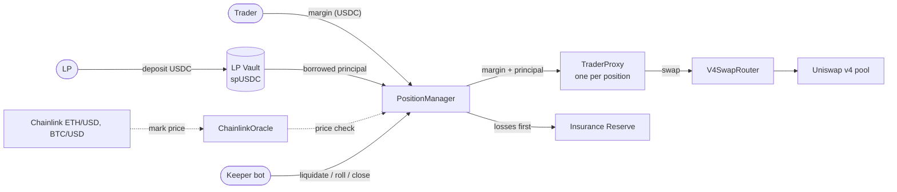
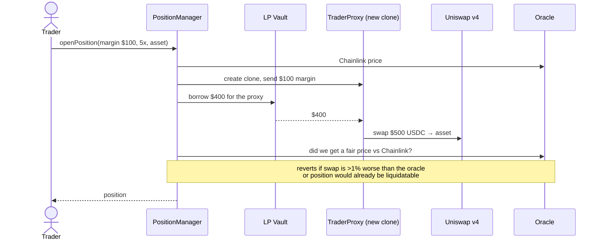
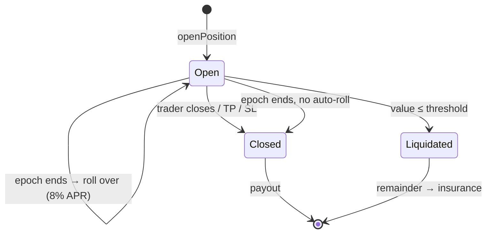
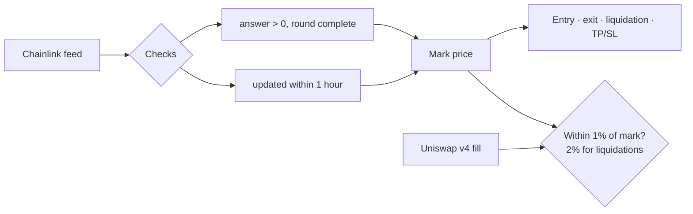
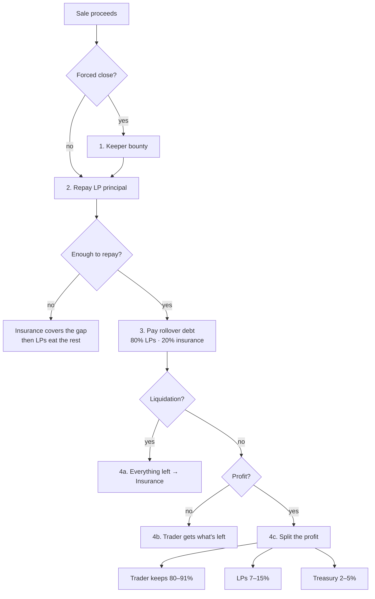
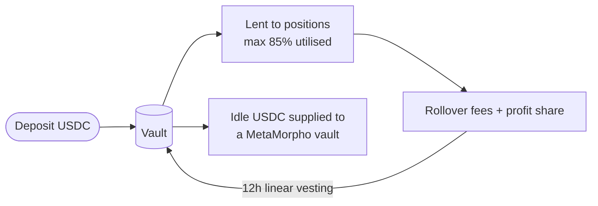
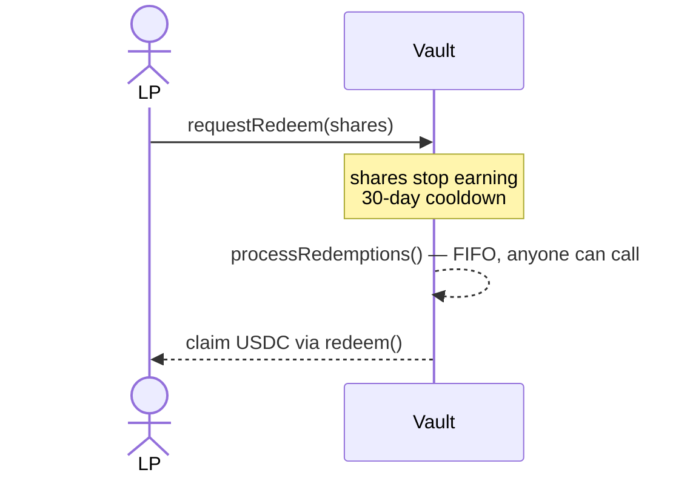
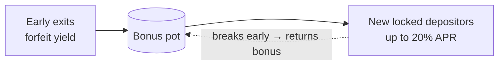
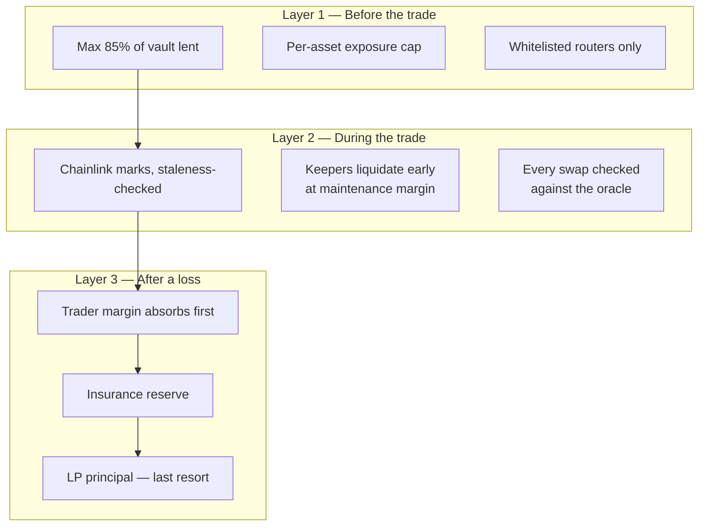

# Fulcrum — Spot-Funded Prop Trading on Base

**Trade ETH and BTC with up to 10x leverage using a pool of lender money. No entry fee. No exit fee. First week free.**

Live app: https://fulcrum-trade.vercel.app · Backtest: https://fulcrum-trade.vercel.app/backtest

- **Traders** put in USDC margin and go long spot ETH or BTC with more buying power.
- **LPs** deposit USDC into a vault and earn yield from trader fees and profit share.
- **Everything is on-chain.** Each trade lives in its own isolated smart wallet.

> Build, test and contribution details: [DEVELOPMENT.md](DEVELOPMENT.md)

## Deployed on Base mainnet (8453), verified on Basescan

| Contract | Address |
|---|---|
| PositionManager (proxy) | [`0x3f3d197d4582d1D10818a115ef7D7413FD11B8d9`](https://basescan.org/address/0x3f3d197d4582d1D10818a115ef7D7413FD11B8d9) |
| LPVault (proxy) | [`0x38669C1C8fb153Ba4cCB40BF08986014EfBa0F26`](https://basescan.org/address/0x38669C1C8fb153Ba4cCB40BF08986014EfBa0F26) |
| ChainlinkOracle | [`0xAEB1d29301aaFCB8cA719e8c1B09C4cD1F6a9CE9`](https://basescan.org/address/0xAEB1d29301aaFCB8cA719e8c1B09C4cD1F6a9CE9) |
| InsuranceReserve | [`0x96621c13dc4b6c3588Ad3bFff1B37cc1328b69ff`](https://basescan.org/address/0x96621c13dc4b6c3588Ad3bFff1B37cc1328b69ff) |
| V4SwapRouter | [`0x58640556f82Fa9c7F7447392B5450099EcbbcB96`](https://basescan.org/address/0x58640556f82Fa9c7F7447392B5450099EcbbcB96) |
| TraderProxy implementation | [`0x3b7bB8b3C902A30A53485d431A3733D329587F40`](https://basescan.org/address/0x3b7bB8b3C902A30A53485d431A3733D329587F40) |

Also in [`deployments/base-mainnet.json`](deployments/base-mainnet.json).

---

## 1. The big picture



| Piece | One-line job |
|---|---|
| **PositionManager** | The brain: opens, rolls, closes, liquidates, settles |
| **LPVault** | Holds LP money, lends it to positions, earns yield |
| **TraderProxy** | A tiny wallet per position that holds the spot asset |
| **ChainlinkOracle** | Chainlink ETH/USD and BTC/USD feeds (1h staleness limit) — the mark for every risk check |
| **InsuranceReserve** | Absorbs losses before LPs do |
| **Keeper** | Bot that liquidates, rolls and closes positions; earns a $0.50 bounty. **Required** for liquidations |

---

## 2. Opening a position

Trader brings **$100**, picks **5x** → buys **$500** of ETH or BTC. The vault lends the other **$400**.
How much a wallet may deposit and which leverage it may use depends on its trader level (section 3).



---

## 3. Trader levels

Every wallet starts at Starter. Levels move automatically on each close, from realised PnL since entering the level.

| Level | Max leverage | Max deposit | Lenders' cut of profit | Treasury cut | Move up | Move down |
|---|---|---|---|---|---|---|
| Starter (L0) | 5x | $50 | 15% | 5% | 5 trades and +$25 | never |
| Trader (L1) | 10x | $250 | 10% | 3% | 10 trades and +$100 | at −$50 |
| Pro (L2) | 10x | $1,000 | 7% | 2% | top level | at −$200 |

Levels are owner-configurable (`setLevel`). New traders pay lenders more; proven ones keep more.

---

## 4. Life of a position



**Epochs:** each position lives in 7-day epochs. The **first is free**. After that, a rollover fee of **8% APR on the borrowed amount** is charged.

**Liquidation line** — you are liquidated when:

```
position value  ≤  borrowed + rollover debt + maintenance %
```

| Tier | Borrowed | Maintenance | Rough drop to liquidation |
|---|---|---|---|
| 5x | 4× margin | 4% of size | ~ −16% |
| 10x | 9× margin | 2% of size | ~ −8% |

---

## 5. How prices work (Chainlink)

Marks come from Chainlink's ETH/USD and BTC/USD feeds on Base. Trades fill on Uniswap v4 (WETH/USDC 0.30%, cbBTC/USDC 0.05%), and every fill is checked against the Chainlink price, so pushing the pool cannot fool the protocol.



Trade-offs: a stale or broken feed reverts every priced action until it recovers; in a fast crash, exits wait until the pool is back within the slippage band. An L2 sequencer-uptime check exists (`setSequencerUptimeFeed`) but is off by default.

---

## 6. Where does the money go? (settlement waterfall)

When a position ends, the USDC from selling the spot asset is paid out **in this order**:



**Profit split** is set by the trader's level (section 3): Starter keeps 80%, Trader 87%, Pro 91%.

**Worked example** (Trader level, 10x, $100 margin, price +10%): position sells for $1,100 → repay $900 → $200 left → profit is $100 → trader gets **$187** back (their $100 + $87), LPs get $10, treasury $3.

---

## 7. LP side: deposit, earn, exit



### Exiting is a queue (ERC-7540)



### Stress protection

| When the pool is… | What happens |
|---|---|
| **Calm** (< 80% utilised) | Normal exits |
| **Stressed** (≥ 80%) | Exit forfeits 25% of earned yield → goes to the **bonus pot** |
| **Stressed** | New depositors can lock funds 90 days and share the bonus pot |
| **Any time** | Exits only paid if the pool still survives a **−20% crash** (solvency gate) |



Traders are never affected by any of this: **LP queue logic cannot block, delay, or reduce a trader payout.**

---

## 8. Who protects LP money?



**Why the oracle checks every swap:** otherwise a trader could push a pool's price, trade into it, and make LPs pay the difference. Entry, exit *and* liquidation swaps must land near the oracle price.

---

## 9. Keepers

The keeper bot (`npm run keeper` in `frontend/`) is critical infrastructure. Anyone can run one; it earns a bounty for:


---

## 10. Trust & safety at a glance

- **Isolated custody** — one clone wallet per position; a bug in one cannot touch another.
- **Protocol-built swaps** — callers pass only a minimum output; the contract builds the Uniswap call itself.
- **Balance-checked swaps** — the proxy measures what it actually received, not what the router claims.
- **No payout redirection** — payouts only go to the trader, so a blocklisted trader can't route funds elsewhere.
- **Always-open exits** — closing works even when the protocol is paused.
- **Governance** — ownership moves to governance via `Ownable2Step`; parameters are bounded.

## Known gaps before audit

- **Keepers must run**: if none do, unhealthy positions are not liquidated.
- **Chainlink is a single price source**: a stale feed (over 1 hour) pauses every priced action for that asset.
- **Launch caps are small on purpose**: $10k vault deposit cap, $100 per wallet, 35% of the vault per asset.
- USDC assumed = $1.
- Trailing stop has no on-chain high-water tracking.
- MetaMorpho integration is optional (`IDLE_VAULT` at deploy).
- Solvency gate assumes keepers liquidate promptly.
- Pending exit requests block *all* new allocations (more conservative than spec).

---

## Backtest

`sim/` replays every hour of ETH and BTC since 2020 against real trader behaviour (342 Hyperliquid traders, 6,967 positions) and publishes the results to [Arkiv](sponsors/arkiv/README.md). When lenders ask for 10% a year, deposits settle at about $86k and lenders earn 10.2% APY, with no lender losses in the 7 worst crashes. Details on the [backtest page](https://fulcrum-trade.vercel.app/backtest).

---

**Next:** [DEVELOPMENT.md](DEVELOPMENT.md) for setup, tests, internals and contributing · [frontend/README.md](frontend/README.md) for the app.
