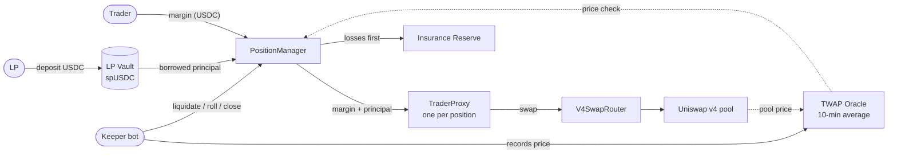
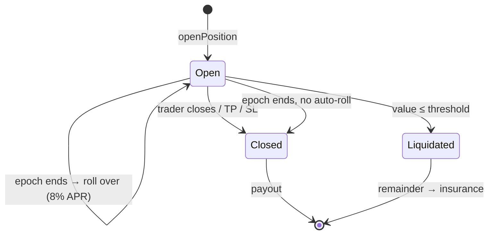
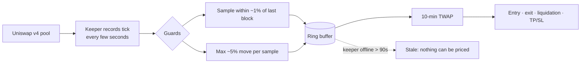
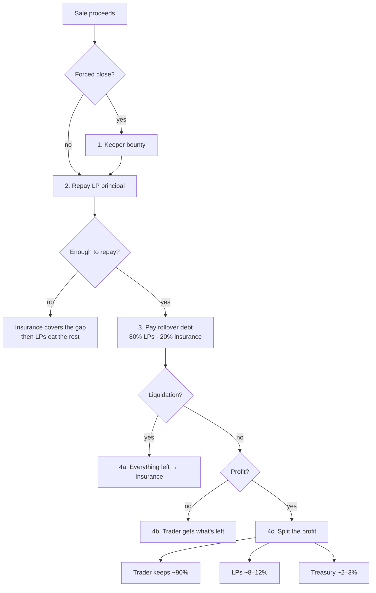
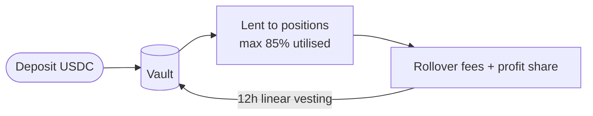
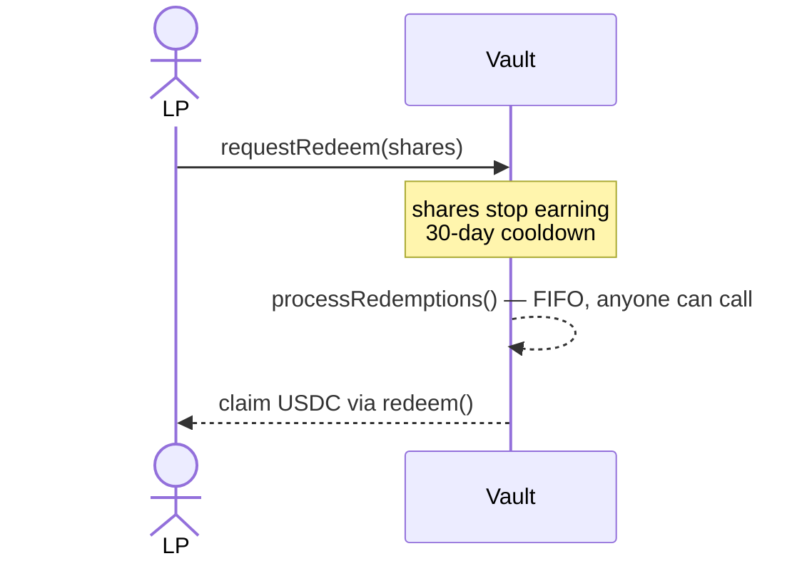
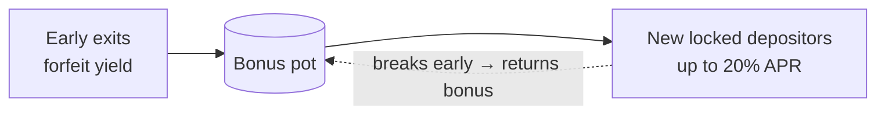
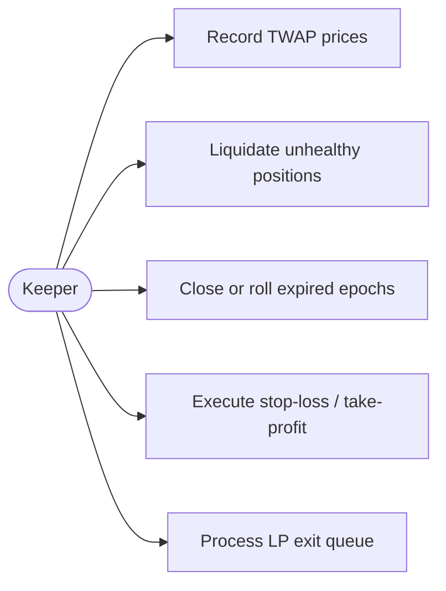

# Fulcrum — Spot-Funded Prop Trading on Arc

**Trade ETH and BTC with 5x or 10x leverage using a pool of LP money. No entry fee. No exit fee. First week free.**

- **Traders** put in USDC margin and go long spot ETH or BTC with more buying power.
- **LPs** deposit USDC into a vault and earn yield from trader fees and profit share.
- **Everything is on-chain.** Each trade lives in its own isolated smart wallet.

> Build, test and contribution details: [DEVELOPMENT.md](DEVELOPMENT.md)

---

## 1. The big picture



| Piece | One-line job |
|---|---|
| **PositionManager** | The brain: opens, rolls, closes, liquidates, settles |
| **LPVault** | Holds LP money, lends it to positions, earns yield |
| **TraderProxy** | A tiny wallet per position that holds the spot asset |
| **UniV4TwapOracle** | 10-minute average of the Uniswap pool price — the source of truth |
| **InsuranceReserve** | Absorbs losses before LPs do |
| **Keeper** | Bot that records prices and liquidates; earns a bounty. **Required** — no keeper, no trading |

---

## 2. Opening a position

Trader brings **$100**, picks **5x** → buys **$500** of ETH or BTC. The vault lends the other **$400**.


---

## 3. Life of a position



**Epochs:** each position lives in 7-day epochs. The **first is free**. After that, a rollover fee of **8% APR on the borrowed amount** is charged.

**Liquidation line** — you are liquidated when:

```
position value  ≤  borrowed + rollover debt + maintenance %
```

| Tier | Borrowed | Maintenance | Rough drop to liquidation |
|---|---|---|---|
| 5x | 4× margin | 4% of size | ~ −16% |
| 10x | 9× margin | 2% of size | ~ −8% |

---

## 4. How prices work (TWAP oracle)

Uniswap pools keep no price history, so a keeper records it. Risk decisions use the **10-minute average**, not the live price, so a quick pool push can't fool the protocol.



Trade-offs: after a deploy or a long keeper outage the oracle needs **10 minutes to warm up**; in a fast crash, exits wait until the pool is back within the slippage band or the TWAP catches up.

---

## 5. Where does the money go? (settlement waterfall)

When a position ends, the USDC from selling the spot asset is paid out **in this order**:



**Profit split**

| Tier | Trader | LPs | Treasury |
|---|---|---|---|
| 5x | 90% | 8% | 2% |
| 10x | 85% | 12% | 3% |

**Worked example** (5x, $100 margin, price +20%): position sells for $600 → repay $400 → $200 left → profit is $100 → trader gets **$190** back (their $100 + $90), LPs get $8, treasury $2.

---

## 6. LP side: deposit, earn, exit



### Exiting is a queue (ERC-7540)



### Stress protection

| When the pool is… | What happens |
|---|---|
| **Calm** (< 80% utilised) | Normal exits |
| **Stressed** (≥ 80%) | Exit forfeits 25% of earned yield → goes to the **bonus pot** |
| **Stressed** | New depositors can lock funds 90 days and share the bonus pot |
| **Any time** | Exits only paid if the pool still survives a **−20% crash** (solvency gate) |



Traders are never affected by any of this: **LP queue logic cannot block, delay, or reduce a trader payout.**

---

## 7. Who protects LP money?


**Why the oracle checks every swap:** otherwise a trader could push a pool's price, trade into it, and make LPs pay the difference. Entry, exit *and* liquidation swaps must land near the oracle price.

---

## 8. Keepers

The keeper bot (`npm run keeper` in `frontend/`) is critical infrastructure. It records oracle prices and earns a bounty for:



---

## 9. Trust & safety at a glance

- **Isolated custody** — one clone wallet per position; a bug in one cannot touch another.
- **Protocol-built swaps** — callers pass only a minimum output; the contract builds the Uniswap call itself.
- **Balance-checked swaps** — the proxy measures what it actually received, not what the router claims.
- **No payout redirection** — payouts only go to the trader, so a blocklisted trader can't route funds elsewhere.
- **Always-open exits** — closing works even when the protocol is paused.
- **Governance** — ownership moves to governance via `Ownable2Step`; parameters are bounded.

## Known gaps before audit

- **TWAP trusts its recorders** (permissioned keepers); if all stop, pricing stops and nobody can be liquidated.
- **Thin pools** (~$15k ETH, ~$8k BTC at time of writing): a few $k moves price several %. Keep exposure caps far below pool depth.
- USDC assumed = $1; no external oracle cross-check.
- Trailing stop has no on-chain high-water tracking.
- MetaMorpho integration is optional and not covered by fork tests.
- Solvency gate assumes keepers liquidate promptly.
- Pending exit requests block *all* new allocations (more conservative than spec).

---

**Next:** [DEVELOPMENT.md](DEVELOPMENT.md) for setup, tests, internals and contributing · [frontend/README.md](frontend/README.md) for the app.
